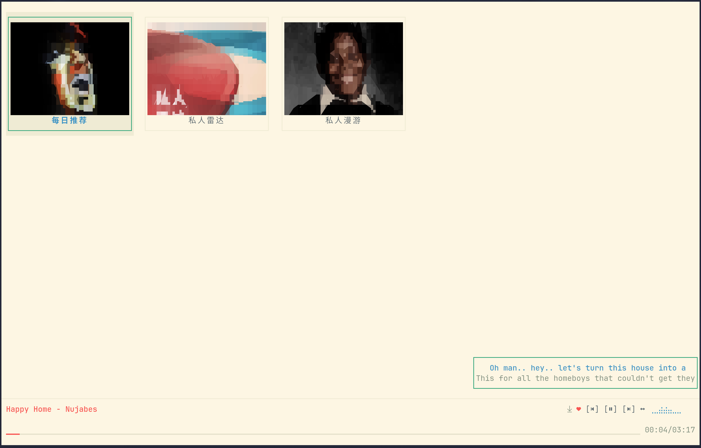
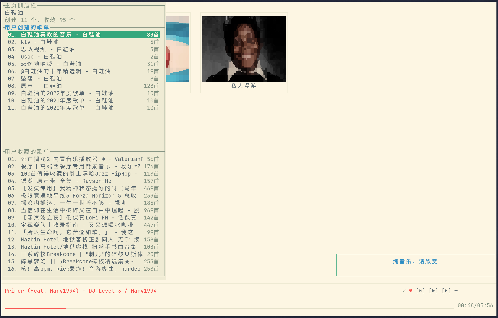
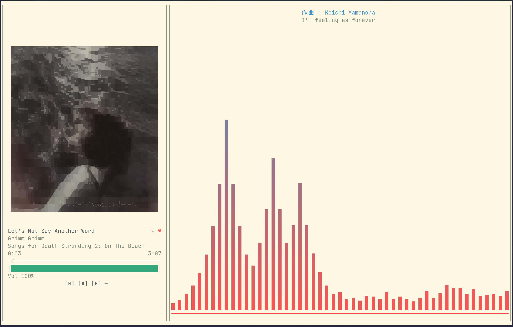
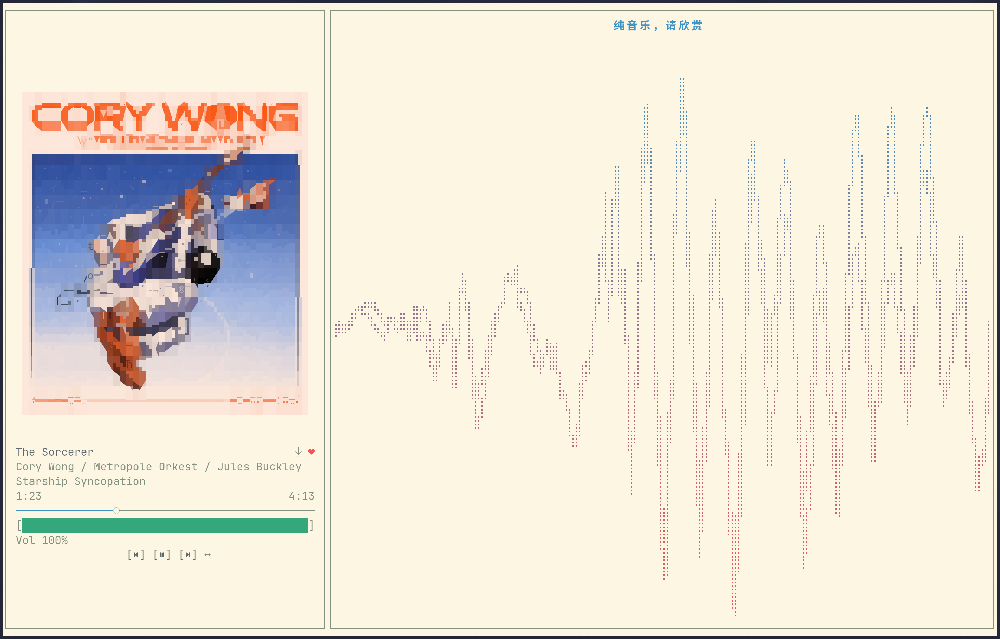
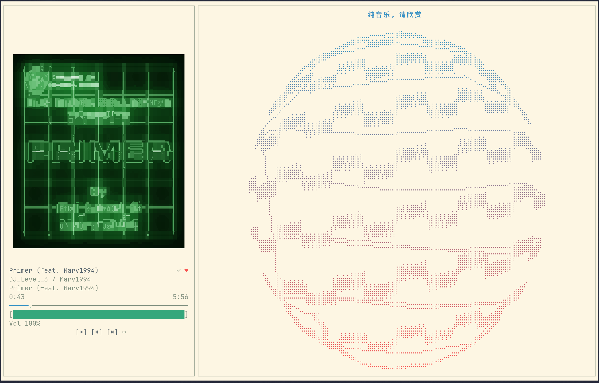
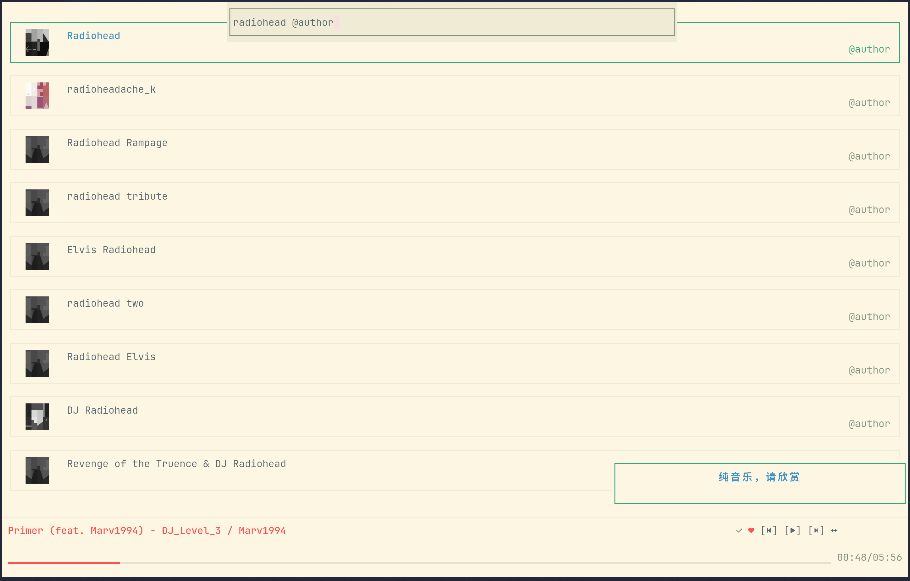

<h1 align="center"></h1>

<p align="center">
	<a href="README.md">English</a>
	&nbsp;&nbsp;&nbsp;|&nbsp;&nbsp;&nbsp;
	<a href="README_zh.md">简体中文</a>
</p>

<p align="center" style="color:gray;">
	A Rust TUI client for NetEase Cloud Music, with an embedded fullscreen playback page.
</p>

<p align="center">
    
    
    
    
    
    
    
	
	
</p>

## Project Overview

CNMPlayer (Customized NetEase Music Player) is a NetEase Cloud Music client that runs in the terminal.
A single process carries two UIs:

- the **host UI** — login, home recommendations, playlist / artist / search pages, a sliding sidebar and a five-row collapsed player bar;
- the **fullscreen playback page** — cover, lyrics, playlist overlay, a 10-band EQ and the visualizers. The fullscreen keybind (default `Ctrl+F`) opens it; inside, `Ctrl+F` or `Esc` returns to the host.

Playback belongs to the host: streaming with a local cache, queue memory, private roam, VIP-aware audio quality and the visualization modes that the other UI draws.

> CNMPlayer is an unofficial client; music copyright belongs to the rights holders, and the cache / download features are for personal offline use only. Read [DISCLAIMER.md](DISCLAIMER.md) before use.

## Screenshots

<p align="center" width="100%">
	
	&nbsp;
	
	<br><sub>Host UI — home recommendations; sidebar with created / collected playlists</sub>
</p>

<p align="center" width="100%">
	
	&nbsp;
	
	<br><sub>Fullscreen playback page — <code>bars</code> spectrum; <code>oscilloscope</code> waveform</sub>
</p>

<p align="center" width="100%">
	
	&nbsp;
	
	<br><sub>Fullscreen <code>vector</code> mode; search results for a suffix query</sub>
</p>

## Features

### Account

- QR code (`F1`), username / email + password (`F2`) and phone + SMS code (`F3`) login
- The session is persisted to `auth/session.toml` and validated on the next start
- Logout from the settings modal (clears the login cookie, playback memory and private-roam data)

### Browsing

- Home: a recommendation tile grid whose first three slots are always `每日推荐` (Daily Recommendations), `私人雷达` (Private Radar) and `私人漫游` (Private Roam); `home_more_recommend` expands the remaining recommendations
- Home sidebar (toggle keybind, default `P`): your created and collected playlists, 100 per fetch and appended when scrolling to the end; `Ctrl+Up/Down` switches section, Enter opens, Esc collapses
- Playlist page — also used for albums, there is no separate album page; a header (cover, title, author, description, track count) above a virtualized track list, 100 tracks per fetch. Browsing and playback share one source-bound cursor, so a page fetched by either is appended to both
- Artist page: avatar, name, hot-song / album / EP / single counts and a tile grid per section
- Search page: a keyword searches artists, playlists and songs at once, with a trailing suffix to narrow the type (see [Search syntax](#search-syntax))
- Private roam: keeps the last played track at the head; reaching the end of the list fetches more (three API calls merged and de-duplicated); the tile cover follows the currently playing roam song
- Navigation: Enter opens or plays, Esc / Left goes back, Tab / Down and Shift+Tab / Up move, PageUp / PageDown jump one page
- Mouse: the wheel scrolls, a single click focuses, a double click activates; the collapsed player bar's previous / play-pause / next, like and repeat-mode buttons and its progress bar are clickable

### Search syntax

The search box (`Ctrl+S`) searches artists, playlists and songs at once; a trailing suffix narrows it to one type.
`@author` and `@artist` are synonyms, and an empty keyword with `@author` lists the artists you follow.

| Query | Results | Enter |
| --- | --- | --- |
| `keyword` | most relevant artists, playlists and songs | depends on the focused row: play the song, open the artist or the playlist |
| `keyword@single` | songs | plays the song, queueing the result set from that row |
| `keyword@album` | albums | opens the album in the playlist layout |
| `keyword@list` | playlists | opens the playlist |
| `keyword@author` / `keyword@artist` | artists | opens the artist page |
| `@author` (no keyword) | followed artists | opens the artist page |

Artists and playlists are capped at the 5 most relevant hits and never paginate; only the song section appends more when you scroll to the end.

### Playback

- Streaming: the song is downloaded into the local audio cache while it plays, and only becomes the cached file after the complete response is written — a partial or cancelled transfer is never played from the cache. The buffered part of the progress bar shows download progress.
- Seeking from the progress bar or inside the fullscreen page, with a pulse animation while the position catches up
- Queue memory (`playback_memory`): queue, current index, repeat mode and the queue's origin list are saved on every track change and restored on startup; the restored track starts from the beginning
- VIP-aware audio quality (`audio_quality`): 9 levels from `standard` to `jymaster`; a non-VIP account is clamped to `exhigh`
- 10-band EQ, ±12 dB (`eq_bands_db`), edited from the fullscreen EQ modal and applied to the live stream
- Like / unlike from the fullscreen page and from the collapsed player bar
- Repeat modes: sequence → shuffle → loop all → loop one
- Playlist playback prefetches the next page when entering the last three loaded tracks, and waits for an unfinished page instead of stopping or wrapping early
- Linux media control (MPRIS, player name `cnmplayer`) with metadata and cover art

### Downloads

- Songs are saved to `cnmplayer/` inside the system music directory (`download_path` overrides it; falls back to `~/Music/cnmplayer/`)
- Entry points: the download button on single-song rows in the host, the button left of the heart on the fullscreen title row, `Ctrl+Alt+D` (host) and `Ctrl+D` (fullscreen); pressing again cancels the download and removes the partial file
- One download runs at a time; extra requests queue up and run in order
- File name is `Title - Artist - Album.<mp3|flac>`, with tags written in: title, artists, album, track number, date, embedded cover and lyrics (Vorbis Comment for lossless, ID3v2 for mp3)
- Download quality and path live in the "Download Settings" page: an absolute path enables downloads; an empty value or the literal `Null` disables them (the download buttons disappear and the quality row greys out)

### Visualization

- `hidden` (shown as "Off" in settings) — the fullscreen right-hand side is collapsed: neither the visualizer nor the lyrics are drawn, and the song info panel stretches across the terminal width
- `lyrics` (shown as "Lyrics") — lyrics only, no visualizer
- `bars` — an internal Rust port of Cava's spectrum algorithm, rendered with eight sub-cell height levels; it is the default and needs no external `cava`
- `oscilloscope` — a real-PCM waveform that smoothly settles to a flat line on pause, stop or audio interruption, and reopens when playback resumes
- `vector` — a Lissajous vectorscope: the left channel drives the horizontal axis and the right channel the vertical one (up is always positive), scaled so the track's loudest moment so far fills the panel. On pause or a sudden cut to silence the figure bursts apart into drifting dots that settle and twinkle until playback resumes
- The collapsed player bar draws a 10-cell braille mini spectrum (blank in `lyrics` and `hidden`), and the narrow small window draws a stereo VU meter fed by a 400 ms momentary LUFS meter (−60…0 LUFS)

Bars and the mini spectrum analyze CNMPlayer's own decoded playback PCM, tapped after the 10-band EQ and before the playback volume — not the microphone, the system output or other applications. The spectrum is a faithful Rust port of [Cava](https://github.com/karlstav/cava)'s algorithm at commit [`6d43df3b2c7882122585c02c064b20009842a6f8`](https://github.com/karlstav/cava/tree/6d43df3b2c7882122585c02c064b20009842a6f8), and its FFT backend is pure Rust (`realfft`). See [THIRD_PARTY_NOTICES.md](THIRD_PARTY_NOTICES.md) for attribution and full license terms.

### Small window mode

Enabled by default (`small_window_display = false` turns it off). It applies to the host's content pages, and takes over as soon as the terminal drops below the thresholds:

| Terminal size | Behavior |
| --- | --- |
| width ≥ 32 and height ≥ 12 | normal UI |
| width ≥ 32, 5 ≤ height < 12 | flat layout: page lyrics on top, the 5-row collapsed player bar at the bottom |
| width ≥ 32, height = 5 | flat layout, one panel at a time: the toggle keybind (default `Alt+X`) slides between the player bar and the lyrics |
| width < 32, height ≥ 12 | narrow layout: full-width stereo LUFS VU bars |
| both dimensions too small | `Terminal too small` |

Entering the mode closes the sidebar and any open overlay. Settings, the search box and the sidebar cannot be opened while it is active, and only quit, previous, next, play-pause, repeat mode, like (collapsed), the small-window toggle key and the flat player bar's mouse targets (previous, play-pause, next, like, repeat mode, progress seek) still respond.

### Interface

- Themes: loaded dynamically from `themes/*.toml` — 20 built-ins, `frappe` by default; drop in your own toml and it joins the cycle. Files that fail validation are skipped, and a broken selected theme falls back to the default
- UI language: `zh` / `en`
- 22 rebindable shortcuts with conflict detection; `Ctrl+Alt+R` restores the defaults
- Transparent background, album-cover border and hint lines
- Startup: a loading page (ASCII title plus progress bar) appears first, while login restore and recommendation fetches run in the background step by step; an unusable saved session hands over to the login page
- About modal with braille art, and a hidden easter egg inside it (the `easter-egg` cargo feature, compiled in by default and removable with `--no-default-features`)

## Installation

### Arch Linux (AUR)

| Package | Contents |
| --- | --- |
| `cnmplayer-bin` | Prebuilt binary from the latest GitHub Release |
| `cnmplayer` | Builds the latest release tag from source |
| `cnmplayer-git` | Builds the `develop` branch |

```bash
# with paru
paru -S cnmplayer-bin
```

### Prebuilt tarballs

Every release publishes `CNMPlayer_vX.Y.Z_linux_amd64.tar.xz`, `CNMPlayer_vX.Y.Z_linux_aarch64.tar.xz` and `SHA256SUMS` on the [Releases page](https://github.com/professor-lee/CNMPlayer/releases). Both tarballs are flat archives containing the `cnmplayer` binary, `LICENSE` and `THIRD_PARTY_NOTICES.md` (including the full MIT notices for Cava and the Rust FFT dependencies).

```bash
# Download SHA256SUMS next to the tarball; verify the downloaded architecture.
sha256sum --check --ignore-missing SHA256SUMS
tar -xJf CNMPlayer_vX.Y.Z_linux_amd64.tar.xz
./cnmplayer
```

### Build from source

```bash
git clone https://github.com/professor-lee/CNMPlayer.git
cd CNMPlayer
cargo build --release
./target/release/cnmplayer
```

Build dependencies on Debian/Ubuntu (the same list is used by CI):

```bash
sudo apt update
sudo apt install -y build-essential cmake pkg-config \
  libasound2-dev libchafa-dev libpipewire-0.3-dev libssl-dev libglib2.0-dev libclang-dev
```

`libchafa-dev` must be chafa ≥ 1.8.0 (the image renderer probes it through `pkg-config`), and `libclang-dev` plus `libpipewire-0.3-dev` are needed because the PipeWire audio backend generates bindings at build time. `libasound2-dev` is a build-time requirement only: `cpal` compiles its ALSA backend unconditionally on Linux, while playback itself goes through PipeWire.

### Requirements

- Linux with PipeWire for audio (the ALSA backend is deprecated), and the chafa shared library at runtime
- A Nerd Font is required for the playback and navigation icons; the application never guesses glyph availability from `TERM`

## First Run and Asset Root

On first run the app creates an asset directory under your OS config directory; on Linux this is usually `~/.config/cnmplayer`.
If `CNMPLAYER_ASSET_DIR` is set, that directory becomes the asset root instead.

The root holds (files appear as you use the app):

- `config/default.toml` — application, playback, keybind and cache settings
- `themes/*.toml` — theme files (the key is the file's `name` field, falling back to the file name); any extra `.toml` dropped here becomes selectable
- `auth/session.toml` — the persisted login cookie
- `playback/session.toml` — the remembered queue (written while `playback_memory` is on)
- `private_roam/session.toml` — the private-roam list, its last played position and the cached cover

The cache root defaults to the OS cache directory (`~/.cache/cnmplayer` on Linux) and can be moved with `cache.path`. It holds:

- `audio/<song_id>__<quality>.audio` — finished downloads; a transfer in flight is a `.part` file and is removed on failure or cancellation (a hard kill can leave one behind)
- `cover/` — cover images fetched for the now-playing track
- `mpris_art/` — cover files exported for the MPRIS player
- `Player.log` and `Player.stderr.log` — application log and the native audio backends' stderr (both capped at 4 MB)

## Configuration

The repository's `config/default.toml` is embedded at build time and is the single source of defaults: first-run configuration, `Config::default()` and missing-field completion (including nested cache settings). User values override the template, and missing fields are saved back on startup. Unparsable files, invalid enum values and zero `ui_fps` return an error without replacing the user file; out-of-range `page_lyrics_pos_x` / `page_lyrics_pos_y` are clamped.

| Key | Default | Values / notes |
| --- | --- | --- |
| `theme` | `frappe` | Any theme key from `themes/*.toml` (20 built-ins, custom files picked up); a broken file falls back to the default |
| `language` | `zh` | `zh`, `en` |
| `visualize` | `bars` | `hidden` (shown as "Off" in settings), `lyrics` ("Lyrics"), `bars`, `oscilloscope`, `vector`; all visualizers are internal |
| `transparent_background` | `true` | Use the terminal background |
| `album_border` | `true` | Border around the fullscreen cover |
| `graphics_protocol` | `halfblocks` | `off` (ASCII art) or `halfblocks` (colored halfblock cover rendering; legacy `auto` / `sixel` / `kitty` / `iterm2` values load as this) |
| `show_hints` | `true` | Hint line on the content pages and in the fullscreen page's panel border |
| `page_lyrics` | `false` | Two-line lyrics overlay on the content pages |
| `page_lyrics_drag` | `true` | Lyrics overlay can be dragged with the mouse |
| `page_lyrics_snap` | `true` | Snap to the nearest edge (left/right/top/bottom, the other axis stays free; only editable while dragging is on) |
| `page_lyrics_pos_x` | `1.0` | Normalized horizontal position of the overlay's top-left (0=left, 1=right) |
| `page_lyrics_pos_y` | `1.0` | Normalized vertical position of the overlay's top-left (0=top, 1=bottom) |
| `small_window_display` | `true` | Compact layouts for small terminals |
| `home_more_recommend` | `false` | Expand the home page beyond the three pinned tiles |
| `default_opening_title` | `""` | Replaces the ASCII banner on the login and loading pages; supports `\n` |
| `audio_quality` | `exhigh` | `standard`, `higher`, `exhigh`, `lossless`, `hires`, `jyeffect`, `sky`, `dolby`, `jymaster`; clamped to `exhigh` without VIP |
| `download_audio_quality` | `exhigh` | Download quality: same option set as `audio_quality`, VIP-aware as well |
| `download_path` | unset | Download directory (absolute; defaults to `<music dir>/cnmplayer/`, falling back to `~/Music/cnmplayer/`); an empty value or the literal `Null` (case-insensitive) disables downloads |
| `playback_memory` | `false` | Persist and restore the queue, index and repeat mode |
| `eq_bands_db` | 10 × `0.0` | EQ gains in dB, edited from the fullscreen EQ modal |
| `bar_number` | `auto` | `auto`, `16`, `32`, `48`, `64`, `80`, `96` (fullscreen spectrum) |
| `bar_channels` | `mono` | `stereo`, `mono` |
| `bar_channel_reverse` | `false` | Draw the right channel on the left (fullscreen spectrum) |
| `bars_gap` | `false` | Leave a gap between bars |
| `ui_fps` | `60` | Positive integer UI submission cap for the host and the fullscreen page, including idle; clean frames may be skipped, and the actual FPS depends on terminal speed and processing cost |
| `cache.path` | unset | Cache directory override (defaults to the OS cache directory) |
| `cache.clean_strategy` | `both` | `size`, `age`, `both` |
| `cache.max_size_mb` | `500` | Size ceiling for the LRU pass |
| `cache.max_age_days` | `7` | Age limit for the TTL pass |
| `cache.clean_on_startup` | `true` | Run the cleanup while starting |
| `keybind_*` | see below | 22 rebindable shortcuts |

Cleanup runs as an age pass followed by a size LRU pass, and only looks at files directly inside the directory.

## Keyboard Shortcuts

### Rebindable

Rebinding syntax: optional `Ctrl` / `Alt` / `Shift`, then a key name (`Esc`, `Enter`, `Space`, `Tab`, `BackTab`, arrows, `Home`, `End`, `PageUp`/`PgUp`, `PageDown`/`PgDn`, `Insert`, `Delete`, `Backspace`, `Plus`, `F1`–`F12`) or a single character.
A binding that collides with another slot is rejected, and `Ctrl+Alt+R` inside the keybind modal restores every default.

| Setting | Default | Effect |
| --- | --- | --- |
| `keybind_search_box` | `Ctrl+S` | Open the search box |
| `keybind_fullscreen` | `Ctrl+F` | Enter the fullscreen page, or return to the host from it |
| `keybind_settings` | `T` | Open the settings modal (also closes it) |
| `keybind_sidebar` | `P` | Toggle the home sidebar / the fullscreen playlist overlay |
| `keybind_quit` | `Q` | Quit |
| `keybind_page_up` | `pageUP` | Scroll one page up (search, playlist) |
| `keybind_page_down` | `pageDown` | Scroll one page down (search, playlist) |
| `keybind_prev` | `Alt+Left` | Previous track |
| `keybind_next` | `Alt+Right` | Next track |
| `keybind_toggle_play_pause` | `Alt+Space` | Play / pause |
| `keybind_toggle_mode` | `Alt+M` | Cycle the repeat mode (host) |
| `keybind_fullscreen_prev` | `Left` | Previous track (fullscreen page only) |
| `keybind_fullscreen_next` | `Right` | Next track (fullscreen page only) |
| `keybind_fullscreen_toggle_play_pause` | `Space` | Play / pause (fullscreen page only) |
| `keybind_fullscreen_toggle_mode` | `M` | Cycle the repeat mode (fullscreen page only) |
| `keybind_fullscreen_eq` | `E` | Open the EQ modal (fullscreen page only) |
| `keybind_fullscreen_eq_reset` | `Alt+R` | Reset the EQ (fullscreen page only) |
| `keybind_toggle_like_fullscreen` | `L` | Like / unlike (fullscreen page only) |
| `keybind_toggle_like_collapsed` | `Alt+L` | Like / unlike from the collapsed player bar |
| `keybind_small_window_toggle` | `Alt+X` | Switch between the flat small-window panels |
| `keybind_download` | `Ctrl+Alt+D` | Download the focused song (press again to cancel) |
| `keybind_download_fullscreen` | `Ctrl+D` | Download the current song (fullscreen page only; press again to cancel) |

The fullscreen-only slots are inert in the host: there they fall through to page navigation instead.

### Fixed shortcuts

- `Esc` — close the current overlay, or go back from the current page
- `Ctrl+C` — quit from any state
- `Ctrl+K` — open the keybind list; press it again inside the list to close the whole modal on either UI, not return to settings. `Esc` retains its parent-navigation behavior.
- `Ctrl+Up` / `Ctrl+Down` — switch the sidebar playlist section (Created / Collected) while the sidebar is open
- `Ctrl+Alt+R` — restore the default keybinds (inside the keybind modal)
- `F1` / `F2` / `F3` — login method (QR / account / phone)

### Per page

Login page:

- `F1` refresh the QR code, `F2` account login, `F3` phone login
- `Tab` / `Down` next field, `Shift+Tab` / `Up` previous field, `Enter` confirm or submit
- `Q` quits while no username / password field is focused

Search box:

- `Enter` runs the search, `Esc` / `Ctrl+S` closes it
- `Home` / `End` / `Left` / `Right` / `Backspace` / `Delete` edit the query; clicking positions the caret

Search, playlist and artist pages:

- `Enter` opens or plays the focused item, `Esc` or `Left` goes back
- `Tab` / `Down` next item, `Shift+Tab` / `Up` previous item
- `PageUp` / `PageDown` move a whole page (search and playlist pages)

Settings modal:

- `Up` / `Down` / `Tab` / `Shift+Tab` move, `Left` / `Right` / `Enter` change a value, `Esc` steps back
- Mouse: the wheel moves the selection, a single click focuses a row and a double click activates it — except in the lyrics subpage, where a single click flips the switch
- Keybind modal: `Enter` starts rebinding, `Esc` cancels it while waiting for input; `Ctrl+K` closes the whole modal and cancels any pending rebinding without changing the binding.

Fullscreen page:

- The host ignores the entry keybind while the terminal is narrower than 50 columns
- `P` opens the playlist overlay, `Up` / `Down` select, `Enter` plays, `Esc` closes it
- `T` opens the settings modal, `Ctrl+K` the keybind list, `About` is reachable from the settings modal; these modals open and close immediately, including while playback is paused.
- `E` opens the EQ modal; arrows move and adjust a band, `Alt+R` resets it, `Esc` / `E` closes it
- `Up` / `Down` adjust the volume, `Left` / `Right` change track, `Space` plays or pauses, `M` cycles the repeat mode, `L` likes the song
- `Ctrl+F` or `Esc` returns to the host; the mouse clicks the control buttons, the progress bar, the volume bar (click, or press and drag), the like glyph and the playlist rows; clicking an artist name (each name of a multi-artist line is its own target) or the album name leaves the fullscreen page for that artist's or album's page in the host; an open overlay takes the wheel for row focus, and its rows focus on a single click and activate on a double click (the EQ modal sets a band on click)
- If `small_window_display` is on and the terminal drops below 50 columns or 12 rows, the fullscreen page returns to the host by itself
- Entering and leaving fullscreen slides the player layout up from the bottom like a drawer (and back down on exit); mouse controls are active as soon as the entry transition finishes

## Notes

- There are no command line flags. The environment variables are `CNMPLAYER_ASSET_DIR` (asset root) and `COLORTERM` / `TERM` (color capability detection).
- Prebuilt artifacts and AUR packages are produced for Linux `amd64` and `aarch64` only. MPRIS is Linux-only as well.
- API responses and cover downloads have a 30-second deadline covering headers and the complete body; slow audio bodies stay cooperatively cancellable instead of imposing a total song-download deadline.
- Cover art never falls back to ASCII art: at most a transient halfblock preview is shown while loading, and missing or failed artwork stays blank.

## Tech Stack

- Rust 2024
- TUI: ratatui + crossterm
- Async and networking: compio + cyper
- NetEase API client: `ncm-api` (vendored from [ncm-api-rs](https://github.com/imsyy/ncm-api-rs) into `ncm-api-rs/` as a path dependency)
- Playback: rodio + symphonia (mp3 / flac) over PipeWire
- Metadata, artwork and download tags: image + qrcode + lofty
- Image rendering: ratatui-image + chafa
- Visualization: internal Cava Rust spectrum port (realfft) fed by a shared playback PCM tap
- Linux media control: mpris-server
- Fullscreen playback: embedded `src/tmplayer/` UI using host playback and shared configuration

## Development

```bash
cargo run                              # development build
cargo build --release                  # release build
cargo test --workspace --all-targets   # root and vendored crate tests
cargo fmt --all -- --check
cargo clippy --all-targets --all-features -- -D warnings
```

CI (`ci.yml`) runs check and test for the default and `--no-default-features` builds on Rust 1.95 and stable, then fmt and clippy gates for the host and the vendored crate, plus the vendored test suite.
Release (`release.yml`) runs the root and vendored test gates before publishing, publishes `SHA256SUMS` alongside the `x86_64` and `aarch64` tarballs, and maintains the AUR packages.

## Related Projects

- [ncm-api-rs](https://github.com/imsyy/ncm-api-rs): the NetEase Cloud Music API client vendored in `ncm-api-rs/`

## Disclaimer

The full disclaimer — unofficial client, music copyright, personal-use-only cache and downloads, account risk and liability — is in [DISCLAIMER.md](DISCLAIMER.md).

## License

CNMPlayer is licensed under [AGPL-3.0-only](LICENSE).

Third-party attributions and license notices for vendored code, adapted algorithms and the FFT dependencies are documented in [THIRD_PARTY_NOTICES.md](THIRD_PARTY_NOTICES.md), which is also included in the prebuilt release archives.

See [CITATION.cff](CITATION.cff) for the standard citation metadata and upstream references.

---
## Star History

[](https://www.star-history.com/?repos=professor-lee%2FCNMPlayer&type=date&legend=top-left)
